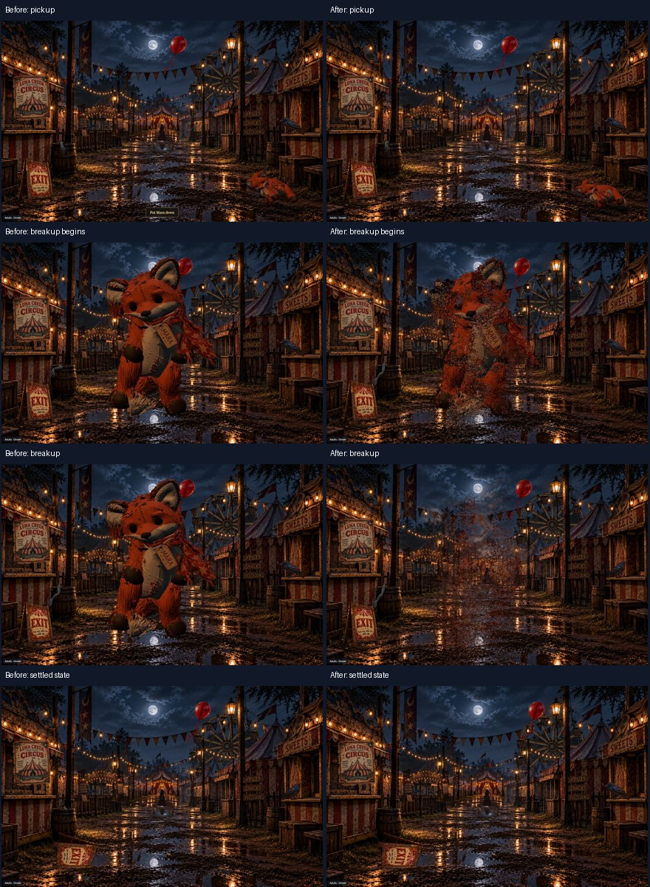
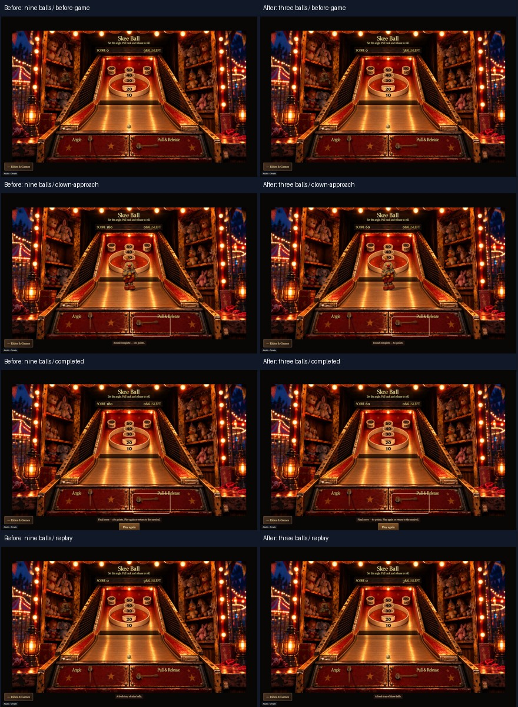

# Dreamscapes playtesting and gameplay corrections — November 3, 2026

Implemented on `codex/dreamscapes-autonomous-playtesting`, based on the latest relevant Mara branch at `03f1b914`. Nothing merged or deployed. Original images, models, lighting, scene composition, carousel mechanics, cabinet geometry and clown design remain unchanged. The recommendation engine is outside this change.

## Result

- The reusable Playwright runner starts a route-aware loopback server, uses isolated browser sessions, navigates player controls, records screenshots and WebM video, collects browser/network errors, and produces HTML and JSON reports. Installation and repeatable commands are in [AUTONOMOUS-PLAYTESTING.md](AUTONOMOUS-PLAYTESTING.md).
- Mara keeps the established 1.65-second limp pickup and starts crumbling at the center. Actual textured surface fragments detach, tumble, shrink and fall, accompanied by the existing dust. Long fur strips are subdivided so they do not become large triangular confetti. The fleeting put-down control is removed. Her body disappears; the original three-face printed tag lands on the ground.
- Skee Ball now permits three launches per game. The third ball scores before the existing clown event starts. There is no fourth prepared ball; the event occurs once, finishes normally, and replay restores three balls and zero score.

## Automated verification

**22 distinct candidate cases passed across targeted runs**, plus a phone integration rerun and an original nine-ball baseline replay. [summary.json](../verification/autonomous-playtesting-2026-11-03/summary.json) records the exact runtime hashes, cases, diagnostics and review boundaries.

| Scope | Cases | Result |
| --- | ---: | --- |
| Four bands × desktop/phone scene exploration | 8 | Passed |
| Three carousel styles × desktop/phone, two sampled revolutions | 6 | Passed |
| Default/center/early Mara sequences × desktop/phone | 6 | Passed |
| Three-ball Skee Ball × desktop/phone | 2 | Passed |
| Additional phone Carousel → Skee Ball → Carousel path and canvas preservation | 1 rerun | Passed |
| Original nine-ball Skee Ball through baseline module interception | 1 baseline | Passed |

Desktop viewport: 1440 × 900. Phone viewport: 390 × 844, with touch emulation; the final Skee Ball phone game uses touchscreen dragging. All three shots scored 20 points in the candidate test, producing totals 20 → 40 → 60 and remaining counts 2 → 1 → 0. Exactly three balls were prepared/launched and one clown event began. Replay and a second reduced-motion game also passed. The original baseline scored 180 from nine equivalent shots and reset to nine balls.

The local-route contract test passed. The build verified all **172 runtime manifest entries**, 20 Ornate GLBs and 40 variant GLBs. No original visual asset bytes changed. Both Vercel configuration roots disable automatic deployment of this review branch.

## Visual review performed

The reviewing agent opened the actual contact sheets linked below, rather than inferring visual quality from assertions. These are live captures; the Mara checkpoints are not exact time-matched overlays. The timestamp in a comparison caption is the runtime state read after screenshot capture, so capture latency can advance that value.

### Mara: before/after and timing decision

Both timing options were played and inspected on desktop and phone. **Center-start is retained**: the player can read the limp lift before the body breaks apart. Early breakup is more abrupt and loses much of the recognizable pickup before arrival. It remains an explicitly local review option, not a new player mechanic.

| Comparison | Lift and center arrival | Breakup and disappearance |
| --- | --- | --- |
| Desktop | [View](../verification/autonomous-playtesting-2026-11-03/mara-desktop-lift.jpg) | [View](../verification/autonomous-playtesting-2026-11-03/mara-desktop-crumble.jpg) |
| Phone | [View](../verification/autonomous-playtesting-2026-11-03/mara-mobile-lift.jpg) | [View](../verification/autonomous-playtesting-2026-11-03/mara-mobile-crumble.jpg) |

The inspected frames show the original appearance and limp pose, breakup into small textured fragments, descending dust, and a final scene without a floating body remnant. The printed tag is preserved and settles on the ground. The earlier before-capture's settled-state image was saved by the first harness as `FAILURE.jpg` because that early harness incorrectly treated navigation-cancelled requests as failures; its gameplay/settled-state assertions had completed. That classification is fixed, and the original diagnostic files remain in local evidence.

### Skee Ball: before/after and complete event

Inspected the cabinet, shot results, clown approach, evaporation, full-screen face, completed game and replay on both layouts: [desktop sequence](../verification/autonomous-playtesting-2026-11-03/skee-three-ball-desktop.jpg), [phone sequence](../verification/autonomous-playtesting-2026-11-03/skee-three-ball-mobile.jpg). The cabinet, controls, scoring targets and clown appearance remain consistent with the baseline.

### Carousel

Inspected the first and subsequent revolution sheets for all three styles and both viewports:

| Style | Desktop | Phone |
| --- | --- | --- |
| Ornate | [View](../verification/autonomous-playtesting-2026-11-03/carousel-ornate-desktop.jpg) | [View](../verification/autonomous-playtesting-2026-11-03/carousel-ornate-mobile.jpg) |
| Plain | [View](../verification/autonomous-playtesting-2026-11-03/carousel-plain-desktop.jpg) | [View](../verification/autonomous-playtesting-2026-11-03/carousel-plain-mobile.jpg) |
| Stuffed | [View](../verification/autonomous-playtesting-2026-11-03/carousel-stuffed-desktop.jpg) | [View](../verification/autonomous-playtesting-2026-11-03/carousel-stuffed-mobile.jpg) |

No obvious new detachment or drift appears in these inspected samples. Automated checks cover every occupied mount's ancestry, pole endpoints, collar/anchor motion, fixed registration, rotation and context health. There is no separately implemented rider system to certify. Sampling advances an isolated test's RAF timestamps by nine seconds per checkpoint, spanning two revolutions; this is not a continuous 144-second performance test. The sampler waits for the shared renderer to consume the new pose, and compares circular angles across wraparound. Earlier sampler failures are retained locally and are superseded by the six passing carousel reruns.

## Additional observations left unchanged

- Phone age buttons remain approximately 13 CSS pixels high, with small painted labels.
- Some geographic paths require panning before touch access; the runner uses those player controls rather than forced clicks or navigation API calls.
- The Skee Ball counter remains cramped beside its painted label, and the phone cabinet occupies a relatively small letterboxed area.
- Zora and the Ferris platform remain primarily scenery/navigation rather than substantial decision encounters.

These pre-existing experience limitations were not redesigned. Physical phones, Safari/WebKit hardware behavior, and sustained hardware performance have not been certified. Fragmentation temporarily creates approximately 130,000 small surface triangles in these captures; physical-device profiling remains useful. Occluded saddle/pole intersections cannot be conclusively certified by screenshots alone. There is no automated artistic-quality score.

## Evidence and next task

The committed contact sheets and machine-readable summary are portable review evidence. Full videos, individual frames, earlier failures, final HTML reports and short review clips remain under ignored `playtest-artifacts/`; open `playtest-artifacts/review.html` locally for the review index. Generate fresh artifacts with the documented runner commands.

**Recommended next autonomous task:** enlarge the phone age-band hit areas and improve their selection affordance while preserving the opening artwork, then use the existing touch tests and screenshots to verify the change.
