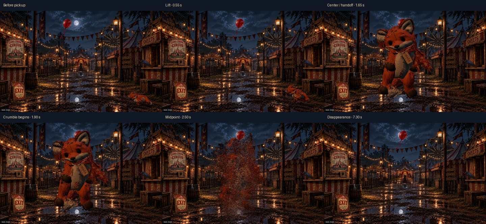

# Ending refinement review

Approved refinement pass for draft PR #350 on `codex/dreamscapes-autonomous-playtesting`, based on `7c9a27a9`. The PR remains a draft; no merge or deployment is part of this change.

## View the result

Open **http://127.0.0.1:4222/** while the local review server is running. The page contains:

- Mara's clean 30 fps engine render and an independent live browser recording.
- A complete live three-ball Skee-Ball recording with the revised ending.
- A clean 30 fps rendering of the clown ending alone.
- Clown before/after frames in desktop, phone, and landscape layouts.
- Mara's six checkpoints in all three layouts.
- Links to replay both effects in the live local game.

The review render advances the existing engine in 1/30-second steps and encodes those frames at 30 fps. It is for visual evaluation, not a claim that live playback always maintains 30 fps. The separately labeled live captures and measurements verify the actual runtime fix.

## Clown

The original `clown-closeup.png` is unchanged. A reversible display grade lowers brightness to 64%, saturation to 58%, and adds modest contrast plus soft edge shading. The crop is 8% closer; an explicit facial anchor centers the face in portrait and landscape instead of relying on the whole image's bounds and hat. The hop, approach, evaporation, pom-pom cue, one-second face, completion, and replay structure are preserved.


[All three layouts](../verification/ending-refinement-2026-11-03/clown-before-after.jpg)

## Mara diagnosis and correction

The visible pause was reproducible in the live browser; it was not only a video-player artifact. At the end of the lift, the browser synchronously skinned the source surface, subdivided it into approximately 131,000 fragments, sampled 26,000 grains, and initialized new rendering programs. The measured geometry build took **2,693 ms**, with a **3,783 ms** gap between frames at the handoff.

The effect now prepares its geometry, lift framing, and GPU programs before playback. Warmup uses the same output color space as the visible renderer to avoid a second shader variant compiling on first appearance. Repeated pickup previews reuse that preparation and restore grain visibility correctly. Preparation refreshes for changed framing, including mobile panning; the target remains fixed during playback. The lift and fragment snapshot meet at the exact existing handoff pose rather than a variable frame overshoot.

The portrait review also exposed a layering error: the distant crow could paint over the held fox. Only during pickup, Mara's canvas now sits above the scene dressing. The resting scene keeps its original layering.

The 1.65-second lift, center-screen crumble timing, original texture, physical fragments, dust, and three surviving tag faces remain. No substantial effect redesign was made.

| Checkpoint | Time after pickup |
|---|---:|
| Before pickup | Before interaction |
| Lift | 0.55 s |
| Center-screen handoff | 1.65 s |
| Start of visible crumble | 1.90 s |
| Midpoint | 2.50 s |
| Complete disappearance and settled tag | 7.30 s |



## Verification

`verification/ending-refinement.cjs` passes in desktop 1440×900, emulated portrait phone 390×844, and landscape 844×390. It checks that no geometry is built during the running pickup, repeated previews reuse preparation, the body disappears, the original tag settles, the facial anchor stays centered, the face cue retains its timing, three shots trigger one ending, replay resets correctly, and reduced motion suppresses the scare. No browser errors were reported.

Measured handoff gaps in the final run were **34 ms desktop**, **17 ms phone**, and **17 ms landscape**, compared with the previous 3.8-second freeze. These are local headless-browser measurements, not physical-device performance guarantees. Occasional resource-dependent frame delays remain distinct from the removed multi-second handoff work.

The build verifies all **172 runtime files**, including unchanged original artwork and GLBs. The original checkpoint manifest is preserved; only the reviewed runtime overrides were refreshed. The route server test and syntax/whitespace checks also pass.

The four ordinary-gameplay cases also pass: Mara and the full three-ball Skee-Ball flow on desktop and mobile. The existing clown lifecycle regression passes on desktop, including leaving/returning to the scene, cleanup, cue timing, and replay.

[Compact test results](../verification/ending-refinement-2026-11-03/results.json)

## Repeat locally

From `apps/dreamscapes`, install the existing pinned Playwright dependency and its browser if needed, then run:

```sh
node verification/ending-refinement.cjs
```

Add `--capture` to generate the fixed-cadence engine frames under ignored `playtest-artifacts/ending-refinement`. `PLAYWRIGHT_MODULE`, `BROWSER_EXE`, and `DREAMSCAPES_EVIDENCE_DIR` may select an existing local installation and output directory. `DREAMSCAPES_LAYOUT` optionally selects `desktop`, `phone`, or `landscape`.

`--mara-only` runs the warmed pickup, foreground-layer check, repeated preview, and all six checkpoints without repeating the clown cases.

To reopen the existing local evidence, run the following in separate terminals:

```sh
# PowerShell
$env:PORT=4221; node tools/playtest-server.mjs
node tools/review-server.mjs
```

The review server binds only to loopback and serves an exact list of review files. Full recordings, intermediate frames, and diagnostic logs remain ignored local artifacts; the selected comparison sheets and compact results are appropriate repository evidence.
